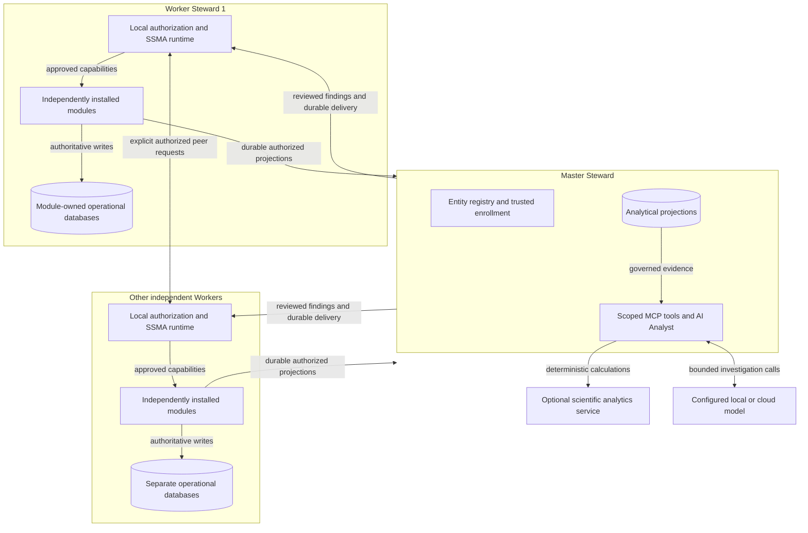

# CEE Steward platform

Steward helps organizations manage independently operated businesses, coordinate authorized work between companies, monitor performance, and investigate opportunities using scientific analytics and AI-assisted evidence review. It also supports humanitarian service organizations, including CEE’s housing, employment and essential-services mission. CEE membership is not required.

Each Worker Steward runs local business operations through independently installed modules and retains its own authoritative records. Master Steward maintains the entity registry and analyzes authorized synchronized projections. Workers continue operating when Master is unavailable. Separately signed modules contribute capabilities, navigation, forms and operations through SSMA and the Steward Shared Design System (SSDS).

**Accepted release: v0.16.0 — Business Automation & Workflow Designer.** All 21 mandatory acceptance gates passed. The selected operator was upgraded in place with accounts, identities, credentials, authoritative records, provider obligations and seven volumes preserved. This is a verified synthetic MVP, not a claim of commercial production readiness.

The release payload was built from `a03d9f4f4ffba794c20381da6066f1af4207bcc6`; final documentation and acceptance evidence are committed separately. The `v0.16.0` tag identifies the accepted evidence revision. No Phase 16 branch or tag has been pushed.

See the [changelog](CHANGELOG.md) for release, patch and unreleased checkpoint summaries. Detailed verification ledgers retain failed attempts, corrected reruns and exact evidence identities.

## Current release status

| Area | Status |
| --- | --- |
| Accepted platform | v0.16.0; see the local release tag and final acceptance report |
| Accepted build source | `a03d9f4f4ffba794c20381da6066f1af4207bcc6`; runtime payload and final evidence commits are distinct |
| Selected operator | Same original installation, 61 running containers: 16 core and 45 modules; seven retained volumes |
| Catalog / Pricing | Catalog 1.4.0 and Pricing Management 1.3.1 installed on all three Workers |
| Workflow capability | Generic visual designer, reviewed publications, durable events, bounded parallel execution, approvals, retries, history and read-only MCP |
| Workflow installation | Worker 1: Inventory 1.7.0, Sales 1.6.0, Procurement 1.4.0 and Automation 1.0.1; Workers 2/3 retain their previous providers |

Release acceptance and preservation evidence: [Phase 16 final acceptance](docs/phase16-final-acceptance.md), [release gates](docs/phase16-release-gates.json), [installation and recovery](docs/phase16-release.md), and [workflow user/presenter guide](docs/phase16-workflow-operations.md). The previous [Phase 15 acceptance](docs/phase15-final-acceptance.md) remains historical evidence. The immutable distribution toolkit retains documentation from its build source; the release tag and accompanying evidence archive contain the final accepted documentation.

Phase 15 was subsequently published to the private GitHub repository as the Phase 16 prerequisite. Remote reference verification is recorded in the [Phase 16 verification ledger](docs/phase16-verification.md). Phase 16 development has not been pushed.

## Run the existing installation

From the repository root, after selecting an existing installation:

```powershell
docker compose up -d --wait
docker compose ps
docker compose logs -f
# Planned shutdown; preserve persistent data.
docker compose down
```

Do not add `-v`: volumes contain retained databases and module state. Installed releases use pinned images; `docker compose up -d --build` does not upgrade them to the current development branch. Installation and release upgrades are explicit, separate operations.

On the current operator machine, `.steward/operator/selection.json` identifies the selected deployment. On another checkout, select an existing installation once:

```powershell
node scripts/select-deployment.mjs PATH_TO_EXISTING_DEPLOYMENT
```

Selection does not create accounts, reset passwords, enroll Workers or recreate databases. Missing selection fails closed. Keep one active operator stack; do not use a new Compose project name to duplicate the selected installation. See [Docker Compose operations](docs/docker-compose-operations.md) for module lifecycle and shutdown details; dated historical counts in that guide describe earlier checkpoints.

The selected operator's sign-in addresses are:

| Application | HTTPS address |
| --- | --- |
| Master | https://master.localhost:26100 |
| Worker 1 | https://worker-1.localhost:26201 |
| Worker 2 | https://worker-2.localhost:26202 |
| Worker 3 | https://worker-3.localhost:26203 |

Use the configured HTTPS origin for sign-in. Presenter credentials are in the selected deployment's private `demo/presenter.json`; reviewer credentials are referenced by the private security/review records. These files are not part of Git or the distribution. See the [presenter guide](docs/phase15-demo.md). Starting containers does not reset credentials.

For a new installation or an in-place upgrade, use a verified accepted distribution and the [release procedure](docs/phase16-release.md). Back up configuration and databases before upgrades. Do not use a fresh installation or volume reset as a substitute for preserving the existing deployment.

## Implemented platform capabilities

- **Core and security:** separate Master/Worker APIs and React frontends, PostgreSQL persistence, trusted enrollment, local authorization, independent Worker availability and durable synchronization.
- **Modules:** signed independent packages, dedicated operational databases, governed SSMA discovery/bindings, provider-pinned obligations, migrations and dynamic SSDS screens. Modules are not compiled into Worker core.
- **Business and commerce:** Inventory, Sales, Procurement, Assets, Workforce and Stock Ledger; Shopify/Printify adapters, controlled commerce simulation and operational intelligence.
- **Mission and sustainability:** Housing, Participant Services, Employment Pathways, Food & Essential Services, Resource Availability, Mission Budget and Resource Coordination, with programme privacy and scoped cross-Worker coordination.
- **Catalog and Pricing:** products/variants, services, subscriptions, rentals, digital offerings and bundles; typed attributes, external mappings, reviewed pricing policies, exact monetary resolution and immutable accepted Sales prices.
- **Workflow automation:** independently installed Business Automation, signed capability discovery, visual definitions and synthetic previews, separate publication review and activation, event-driven Sales/stock continuation, human-approved Procurement drafts and recipient-only internal notifications.
- **Intelligence:** governed Master projections, deterministic Python analytics, scoped MCP tools, local Ollama/Qwen investigations, human-reviewed findings, affected-only delivery and acknowledgments.

Module availability and configuration vary by Worker; a package's presence in a release does not mean it is installed or enabled everywhere.

<!-- steward-module-inventory:start -->
## Module Inventory — v0.16.0

| Module | Version at v0.16.0 release | Purpose | Installation |
| --- | --- | --- | --- |
| Assets (`cee.assets`) | 1.1.0 | Authoritative assets, ownership and facilities with human-reviewed, programme-scoped property management authority. Housing occupancy remains in the independent Housing module. | Worker 2 |
| Business Automation (`steward.automation`) | 1.0.1 | Module-owned workflow definitions and immutable human review. Execution requires separate Worker-governed activation. | Worker 1 |
| Business operations (`cee.operations`) | 1.0.0 | Entity-owned capacity, external storage and warehouse assets. | Worker 1; Worker 2; Worker 3 |
| Business Resource Availability (`steward.finance.resource-availability`) | 1.0.0 | Synthetic entity-owned economic authority, immutable financial evidence and governed resource coordination. No external payments. | Worker 1; Worker 2 |
| Employment Pathways (`steward.employment.pathways`) | 1.1.1 | Synthetic authorized training and employment referrals, deterministic qualification comparisons, human-reviewed placement and retention. | Worker 2 |
| Food & Essential Services (`steward.services.food`) | 1.0.3 | Synthetic programme-scoped meal sessions, essential supplies and human-reviewed referrals. Optional Inventory and Procurement obligations remain pinned to their approved provider. | Worker 3 retains 1.0.2 |
| Housing Management (`steward.housing.management`) | 1.0.3 | Synthetic programme-scoped housing operations with authoritative property references, reviewed placements, reserved units and sealed aggregate disclosure. | Worker 1 retains 1.0.2 |
| Inventory (`cee.inventory`) | 1.7.0 | Persistent item catalog and basic quantities, in an isolated module service and database. | Worker 1; Worker 2 retains 1.5.0; Worker 3 retains 1.6.0 |
| Mission Budget & Funding (`steward.finance.mission-budget`) | 1.0.0 | Synthetic entity-owned economic authority, immutable financial evidence and governed resource coordination. No external payments. | Worker 1; Worker 2; Worker 3 |
| Participant Services (`steward.housing.services`) | 1.0.4 | Synthetic programme-scoped intake, assessed support plans, human-reviewed referrals and private service follow-up. No real participant information. | Worker 3 |
| Pricing Management (`steward.pricing.management`) | 1.3.1 | Independent entity-owned price lists, immutable proposals, separate human reviews and activation, deterministic resolution and historical evidence. No external publishing or payment execution. | Worker 1; Worker 2; Worker 3 |
| Printify (`cee.printify`) | 1.3.0 | Independent SSMA printify module; simulator/live mode and authority remain explicit. | Worker 1 retains 1.1.1; Worker 3 |
| Procurement (`cee.procurement`) | 1.4.0 | Independent persistent procurement business module. Human authorization is required for approval and ecosystem publication. | Worker 1; Worker 2 retains 1.1.0; Worker 3 retains 1.3.0 |
| Resource Coordination (`steward.finance.resource-coordination`) | 1.0.0 | Synthetic entity-owned economic authority, immutable financial evidence and governed resource coordination. No external payments. | Worker 1; Worker 2; Worker 3 |
| Sales (`cee.sales`) | 1.6.0 | Independent persistent sales business module. Human authorization is required for approval and ecosystem publication. | Worker 1; Worker 2 retains 1.3.2; Worker 3 retains 1.5.0 |
| Shopify (`cee.shopify`) | 1.3.0 | Existing SSMA Shopify adapter. Live mode is read-only development-store identity and catalog verification; simulator fulfillment retains its governed workflow. | Worker 1 retains 1.2.0; Worker 3 |
| Simulated Fulfillment Provider (`steward.simulation.fulfillment`) | 1.0.1 | Isolated Printify-compatible SSMA fulfillment simulation. No commercial credentials, external HTTP or chargeable production. | Worker 1; Worker 2 |
| Steward Commerce Simulation (`steward.simulation.commerce`) | 1.1.3 | Continuous synthetic commerce through authorized real Sales/stock services and an isolated local fulfillment provider. No live commerce mutations. | Worker 1; Worker 2 |
| Stock-ledger (`cee.stock-ledger`) | 1.2.0 | Independent SSMA stock-ledger module; simulator/live mode and authority remain explicit. | Worker 1 retains 1.1.0; Worker 2 retains 1.1.0; Worker 3 |
| Universal Catalog (`steward.catalog.universal`) | 1.4.0 | Entity-owned product and service definitions, variants, bundles, provenance and explicit external mappings. External catalogs remain provider-owned and read-only. | Worker 1; Worker 2; Worker 3 |
| Workforce (`cee.workforce`) | 1.3.0 | Authoritative skills, training and positions with opt-in private, programme-scoped mission reservations and human employer decisions. | Worker 1 retains 1.0.2; Worker 3 retains 1.2.0 |

<!-- steward-module-inventory:end -->

## Architecture and authority



Master holds analytical projections, not direct authority over Worker databases.
Each Worker authorizes its own operations and peer requests. Scientific analytics
and a language model are optional analytical services, not Worker availability
requirements. Models cannot grant permissions or authorize business operations.

## Documentation

| Topic | Guide |
| --- | --- |
| Architecture and module development | [SSMA architecture](docs/phase8-architecture.md), [module development](docs/phase7-module-development.md), [workflow authority decision](docs/adr/0044-business-automation-governed-execution.md) |
| Scientific analytics | [Scientific analytics presenter guide](docs/phase12-presenter.md) |
| Catalog and Pricing | [Catalog](docs/phase15-catalog.md), [Pricing](docs/phase15-pricing.md), [business integration](docs/phase15-business-integration.md) |
| External catalogs | [Read-only catalog workflow](docs/phase15-external-catalog.md), [Shopify setup](docs/shopify-development-store.md) |
| Intelligence and AI | [Master intelligence](docs/phase15-master-intelligence.md), [AI investigations](docs/phase15-ai-investigations.md), [contribution methodology](docs/phase15-contribution-methodology.md) |
| Mission operations | [Phase 13 presenter guide](docs/phase13-presenter.md), [acceptance](docs/phase13-final-acceptance.md) |
| Economic sustainability | [Financial workflows](docs/phase14-financial-workflows.md), [presenter guide](docs/phase14-demo.md), [acceptance](docs/phase14-final-acceptance.md) |
| Workflow development and operation | [Developer guide](docs/phase16-workflow-development.md), [operations and recovery](docs/phase16-workflow-operations.md), [release procedure](docs/phase16-release.md) |
| Phase 16 architecture and evidence | [Directive](docs/phase16-instructions.md), [workflow contracts](docs/phase16-workflow-contracts.md), [verification ledger](docs/phase16-verification.md) |
| Release and patch history | [Changelog](CHANGELOG.md) |

## Development and verification

Use Node.js 24.x, npm 10+, Docker with Linux containers, and the OpenSSL/Compose prerequisites described in the release guides. Browser checks require Playwright Chromium. Real local AI validation additionally requires a configured Ollama model; ordinary Worker services do not depend on it.

```powershell
npm ci
npm run build
npm test
node scripts/test-workflow-governance-browser.mjs
node scripts/smoke.mjs PATH_TO_SELECTED_DEPLOYMENT
node scripts/verify-single-stack.mjs
```

The full regression suite uses isolated database/service fixtures and takes time; it is separate from installed-deployment and release acceptance. Do not interpret a passing source build as a completed upgrade.

Recorded verification boundaries:

- **Accepted v0.15.0:** 1,103 Node tests across 69 summaries, plus scientific, browser, clean-installation, upgrade, live read-only catalog and genuine local Qwen acceptance. See the final report for separate counts and limitations.
- **Accepted v0.16.0 built source `a03d9f4`:** 1,287 Node tests / 80 summaries, 88 Python tests, 28 scientific governance checks, 21 component browser checks plus installed business/browser, upgrade, clean-install and recovery acceptance. Counts are separate, not summed into one test total.

Installed Sales/Inventory interruption recovery, human-approved Procurement and internal notifications, parallel execution, provider substitution, read-only MCP, Master-offline workflow execution, clean installation and data-preserving upgrade all passed. See the final report for actual evidence and retained failed attempts.

## Planned roadmap

- Phase 17: AI Integration & Adapter Builder.
- Phase 18: Marketing & Campaign Management.

These are planned capabilities, not implemented release features.

## Operational and production boundaries

Live Shopify and Printify **read-only catalog connectivity** was exercised again after the final Phase 16 upgrade. This does not guarantee future credential or service availability, and does not verify paid orders, production, shipping or live end-to-end commerce. Production/fulfillment demonstrations used explicit simulators and synthetic data. One historical Printify profile remained unavailable while the active profile passed.

AI findings require evidence review and established authorization; models do not grant permissions or execute arbitrary business actions. Unknown costs remain unknown, and estimates are not realized profit. Local-model output is nondeterministic and may fail safely. Source leases can expire and hide findings from current views while preserving immutable history.

Preserve identities, secrets, module authority and original provider obligations. Never commit `.steward` private deployments or credentials, rewrite applied migrations, or silently transfer uncertain production work to another provider. Full offline enrollment remains deferred. Passing MVP acceptance does not establish commercial production readiness, HMIS certification, or financial/regulatory certification.

### Store Marketing increment

The independently packaged Store Marketing module adds campaign and budget planning, human action records, and read-only aggregate Google Analytics 4 reporting. It does not execute ads or establish attribution or profit. [Setup and operating guide](docs/store-marketing.md) covers service-account/property access, private files, explicit store mapping and image-bound egress. [Verification ledger](docs/marketing-verification.md) distinguishes implementation, deployed state and unverified Google-account/live gates. This increment does not change the v0.16.0 release inventory below.
