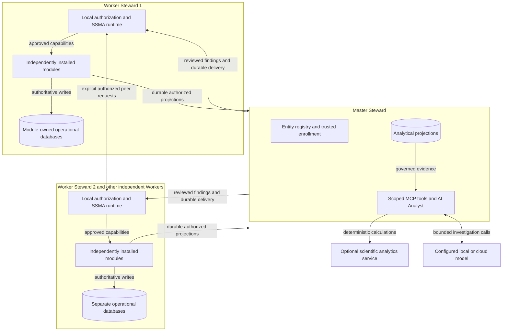

# CEE Steward platform

Steward helps organizations manage independently operated businesses, coordinate authorized work between companies, monitor performance, and investigate opportunities using scientific analytics and AI-assisted evidence review. It also supports humanitarian service organizations, including CEE’s housing, employment and essential-services mission. CEE membership is not required.

Each Worker Steward runs local business operations through independently installed modules and retains its own authoritative records. Master Steward maintains the entity registry and analyzes authorized synchronized projections. Workers continue operating when Master is unavailable. Separately signed modules contribute capabilities, navigation, forms and operations through SSMA and the Steward Shared Design System (SSDS).

**Accepted release: v0.15.0 — Universal Catalog and Pricing Management.** All eighteen mandatory acceptance gates passed. The selected operator installation was upgraded in place, preserving accounts, identities, credentials, module databases, provider obligations and volumes. This is a verified synthetic MVP, not a claim of commercial production readiness.

**Development: Phase 16 — Business Automation & Workflow Designer, targeting v0.16.0.** Implementation is in progress on `codex/phase16-business-automation`; there is no accepted v0.16.0 release. A Phase 16 candidate is installed for acceptance; its verified upgrade is not completed release acceptance. The root package version is 0.16.0 for candidate preparation; development source on this branch is not an accepted release payload.

See the [changelog](CHANGELOG.md) for release, patch and unreleased checkpoint summaries. Detailed verification ledgers retain failed attempts, corrected reruns and exact evidence identities.

## Current release and development status

| Area | Status |
| --- | --- |
| Accepted platform | v0.15.0; tag commit `300e4caeb876b51ee92ff7f9ecc2d4c5582cd72f` |
| Accepted build source | `4c07ffb0980e891f917f1755ff380e4241219f40`; build and acceptance-evidence commits are distinct |
| Selected operator | Phase 16 candidate `18b0ae7` upgraded in place with preservation checks passed; one stack, 61 containers (16 core and 45 modules). Final release acceptance remains incomplete |
| Catalog / Pricing | Catalog 1.4.0 and Pricing Management 1.3.1 installed on all three Workers |
| Phase 16 source | Governed definitions, generic designer/preview, durable parallel execution, events, Sales/Inventory/Procurement and internal notifications implemented in source; installed acceptance incomplete |
| Phase 16 installation | Worker 1: Inventory 1.7.0, Sales 1.6.0, Procurement 1.4.0 and Automation 1.0.1 installed; Workers 2/3 retain their previous packages. Workflow execution acceptance is still in progress |

Release acceptance and preservation evidence: [Phase 15 final acceptance](docs/phase15-final-acceptance.md), [release gates](docs/phase15-release-gates.json), [installation and upgrade procedure](docs/phase15-release.md), and [presenter guide](docs/phase15-demo.md). Some procedural documents retain candidate-stage instructions; the final acceptance report and accepted distribution manifest establish release status.

Phase 15 was subsequently published to the private GitHub repository as the Phase 16 prerequisite. Remote reference verification is recorded in the [Phase 16 verification ledger](docs/phase16-verification.md). Phase 16 development has not been pushed.

## Run the existing installation

From the repository root, after selecting an existing installation:

```powershell
docker compose up -d --wait
docker compose ps
docker compose logs -f
# Planned shutdown; preserve persistent data.
docker compose down
```

Do not add `-v`: volumes contain retained databases and module state. Installed releases use pinned images; `docker compose up -d --build` does not upgrade them to the current development branch. Installation and release upgrades are explicit, separate operations.

On the current operator machine, `.steward/operator/selection.json` identifies the selected deployment. On another checkout, select an existing installation once:

```powershell
node scripts/select-deployment.mjs PATH_TO_EXISTING_DEPLOYMENT
```

Selection does not create accounts, reset passwords, enroll Workers or recreate databases. Missing selection fails closed. Keep one active operator stack; do not use a new Compose project name to duplicate the selected installation. See [Docker Compose operations](docs/docker-compose-operations.md) for module lifecycle and shutdown details; dated historical counts in that guide describe earlier checkpoints.

The selected operator's sign-in addresses are:

| Application | HTTPS address |
| --- | --- |
| Master | https://master.localhost:26100 |
| Worker 1 | https://worker-1.localhost:26201 |
| Worker 2 | https://worker-2.localhost:26202 |
| Worker 3 | https://worker-3.localhost:26203 |

Use the configured HTTPS origin for sign-in. Presenter credentials are in the selected deployment's private `demo/presenter.json`; reviewer credentials are referenced by the private security/review records. These files are not part of Git or the distribution. See the [presenter guide](docs/phase15-demo.md). Starting containers does not reset credentials.

For a new installation or an in-place upgrade, use a verified accepted distribution and the [release procedure](docs/phase15-release.md). Back up configuration and databases before upgrades. Do not use a fresh installation or volume reset as a substitute for preserving the existing deployment.

## Implemented platform capabilities

- **Core and security:** separate Master/Worker APIs and React frontends, PostgreSQL persistence, trusted enrollment, local authorization, independent Worker availability and durable synchronization.
- **Modules:** signed independent packages, dedicated operational databases, governed SSMA discovery/bindings, provider-pinned obligations, migrations and dynamic SSDS screens. Modules are not compiled into Worker core.
- **Business and commerce:** Inventory, Sales, Procurement, Assets, Workforce and Stock Ledger; Shopify/Printify adapters, controlled commerce simulation and operational intelligence.
- **Mission and sustainability:** Housing, Participant Services, Employment Pathways, Food & Essential Services, Resource Availability, Mission Budget and Resource Coordination, with programme privacy and scoped cross-Worker coordination.
- **Catalog and Pricing:** products/variants, services, subscriptions, rentals, digital offerings and bundles; typed attributes, external mappings, reviewed pricing policies, exact monetary resolution and immutable accepted Sales prices.
- **Intelligence:** governed Master projections, deterministic Python analytics, scoped MCP tools, local Ollama/Qwen investigations, human-reviewed findings, affected-only delivery and acknowledgments.

Module availability and configuration vary by Worker; a package's presence in a release does not mean it is installed or enabled everywhere.

## Architecture and authority



Master holds analytical projections, not direct authority over Worker databases.
Each Worker authorizes its own operations and peer requests. Scientific analytics
and a language model are optional analytical services, not Worker availability
requirements. Models cannot grant permissions or authorize business operations.

## Documentation

| Topic | Guide |
| --- | --- |
| Catalog and Pricing | [Catalog](docs/phase15-catalog.md), [Pricing](docs/phase15-pricing.md), [business integration](docs/phase15-business-integration.md) |
| External catalogs | [Read-only catalog workflow](docs/phase15-external-catalog.md), [Shopify setup](docs/shopify-development-store.md) |
| Intelligence and AI | [Master intelligence](docs/phase15-master-intelligence.md), [AI investigations](docs/phase15-ai-investigations.md), [contribution methodology](docs/phase15-contribution-methodology.md) |
| Mission operations | [Phase 13 presenter guide](docs/phase13-presenter.md), [acceptance](docs/phase13-final-acceptance.md) |
| Economic sustainability | [Financial workflows](docs/phase14-financial-workflows.md), [presenter guide](docs/phase14-demo.md), [acceptance](docs/phase14-final-acceptance.md) |
| Workflow development and operation | [Developer guide](docs/phase16-workflow-development.md), [operations and recovery](docs/phase16-workflow-operations.md), [candidate release procedure](docs/phase16-release.md) |
| Phase 16 development | [Directive](docs/phase16-instructions.md), [workflow contracts](docs/phase16-workflow-contracts.md), [verification ledger](docs/phase16-verification.md) |
| Release and patch history | [Changelog](CHANGELOG.md) |

## Development and verification

Use Node.js 24.x, npm 10+, Docker with Linux containers, and the OpenSSL/Compose prerequisites described in the release guides. Browser checks require Playwright Chromium. Real local AI validation additionally requires a configured Ollama model; ordinary Worker services do not depend on it.

```powershell
npm ci
npm run build
npm test
node scripts/test-workflow-governance-browser.mjs
node scripts/smoke.mjs PATH_TO_SELECTED_DEPLOYMENT
node scripts/verify-single-stack.mjs
```

The full regression suite uses isolated database/service fixtures and takes time; it is separate from installed-deployment and release acceptance. Do not interpret a passing source build as a completed upgrade.

Recorded verification boundaries:

- **Accepted v0.15.0:** 1,103 Node tests across 69 summaries, plus scientific, browser, clean-installation, upgrade, live read-only catalog and genuine local Qwen acceptance. See the final report for separate counts and limitations.
- **Phase 16 intermediate baseline `d3c3d1d`:** uninterrupted regression passed 1,222 tests across 76 summaries with zero failures, cancellations or skips. This predates the later Sales continuation change.
- **Sales continuation checkpoint `3b3dafa`:** six new domain tests, 24 Sales/Catalog integration tests, seven existing business tests and eight publication tests passed. Seven governance browser checks passed at the preceding recovery checkpoint. These are targeted/component results, not installed Phase 16 release acceptance.

Phase 16 still requires procurement and notification/task integration, bounded parallel dispatch, remaining designer work, installed business scenarios, outage/provider-substitution acceptance, final full regressions, candidate packaging and a data-preserving upgrade before tagging v0.16.0.

## Operational and production boundaries

Live Shopify and Printify **read-only catalog connectivity** was exercised during Phase 15 acceptance. That historical result does not guarantee current credentials or service availability, and does not verify paid orders, production, shipping or live end-to-end commerce. Production/fulfillment demonstrations used explicit simulators and synthetic data. One historical Printify profile remained unavailable while the active profile passed.

AI findings require evidence review and established authorization; models do not grant permissions or execute arbitrary business actions. Unknown costs remain unknown, and estimates are not realized profit. Local-model output is nondeterministic and may fail safely. Source leases can expire and hide findings from current views while preserving immutable history.

Preserve identities, secrets, module authority and original provider obligations. Never commit `.steward` private deployments or credentials, rewrite applied migrations, or silently transfer uncertain production work to another provider. Full offline enrollment remains deferred. Passing MVP acceptance does not establish commercial production readiness, HMIS certification, or financial/regulatory certification.
