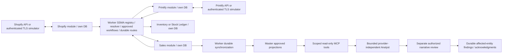

# MArch and Smart Steward Module Architecture

Master owns the entity registry, enrollment authority, approved analytical copies, investigations and findings. Each Worker owns its installation identity, authentication, module catalog, governance and operational availability. Master is never in the Worker health or local business execution path. Every Worker uses the same core artifacts and separate PostgreSQL/storage/configuration.

The runtime discovers providers exclusively from verified installed descriptors. It never loads user-supplied scripts or arbitrary frontend assets. Signed declarative screens arrive through the existing module discovery API. Module-owned API permissions are enforced by both Worker gateway and module service. The host's private control channel verifies Worker signatures, TLS identity and replay nonces. Only each module's own secret subpath and database credential enter that service.

Bindings pin a capability schema, provider package digest, provider installation operation ID, entity and approver. Workflows undergo proposal, approval and activation. Activation selects a version for new aggregates. Original aggregate workflows remain pinned. Explicitly retained bindings may serve original obligations but never new ones. Every delivery rechecks trust, configuration, current installation and authority. Incompatible changes suspend; they never transfer an obligation implicitly.

Module inbox/outbox effects and their local business mutations are transactional. The Worker routes capability commands through the same SSMA contracts and module receipt mechanism as explicitly invoked workflows. External manufacturing and channel writes additionally use module-owned issuance journals committed before sending. Reconciliation inspects authoritative external identity, lines/status/tracking. Unknown outcomes suspend without destructive rollback or blind repeated commitments.

Canonical stock/order/production/status/channel contracts are in the module-only commerce kit. Shopify retains source product/variant/order identities and inventory observations. Explicit mappings bridge canonical SKUs and Printify product/variant identifiers. Inventory providers retain local stock authority. Master receives locally approved, strictly validated commerce projections with source revisions, units and currency. Exact-cent analytical services preserve unknown values and estimated cost provenance. The model selects authorized read-only tools; it cannot grant permissions, submit production or publish findings.

See ADRs 0018–0019, the [SSMA reference](phase8-ssma.md), [connector configuration and recovery](phase8-commerce.md), and [verification](phase8-verification.md). Deferred enrollment/offline grants, external module repositories, live commercial account validation, invoice reconciliation, delegated governance and automatic uncertain-effect resolution remain separate work.
